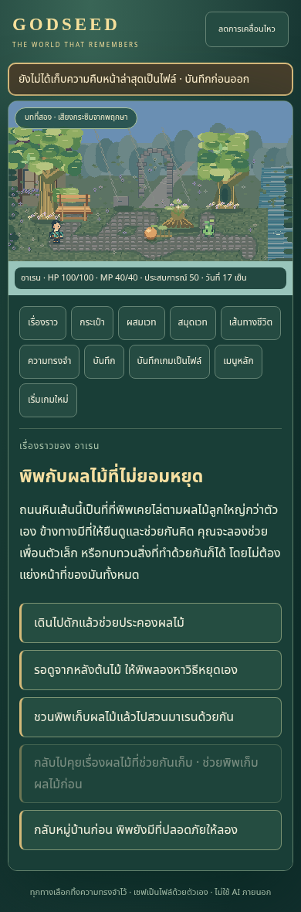
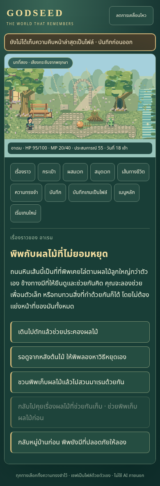
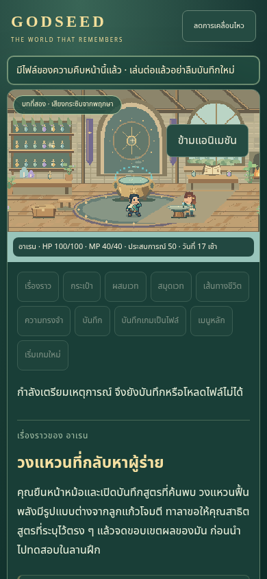
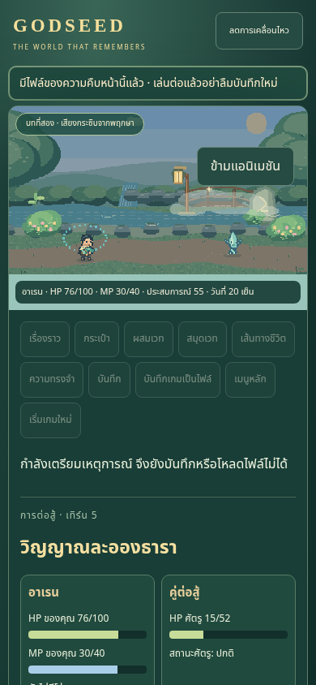

# GODSEED EVOLUTION REPORT — Session25 / 0.15.0

วันที่ 2026-11-09 UTC · Source `d6ee99d413576df02bbe7ccfa9dd63ed3fcbb670` · [PR #26](https://github.com/Ninon0406/alltest/pull/26) · Merge `728183fb0198cf4cc09cfb356a625cd4d38fa778`

[เล่นเวอร์ชันที่ตรวจจริง](https://ninon0406.github.io/alltest/) · [ผลตรวจรวม](verification.json) · [Checklist ทั้ง109งาน](../../../../GODSEED_MASTER_ROADMAP.md)

## 1. สิ่งที่ตรวจพบก่อนเริ่ม

ต่อจาก0.14/49b9113 มีตอนจบบทแรกสามแนวและช่วงเปิดARC2ที่กลับมาเล่าต่อได้ แต่มีเพียงสองหลักสูตรเส้นทางชีวิต. ตรวจโค้ด/Story Graph/เซฟ/ภาพอ้างอิง/ประวัติและผลจริงก่อนเพิ่มงาน. Mainรอบก่อน42472995227เสร็จ165/165ใน30.5mและBuild/DeploySUCCESSแล้ว. ไม่เริ่มโปรเจกต์ใหม่และไม่ลบระบบเดิม

## 2–4. ประสบการณ์ที่เพิ่มจริง

เพิ่มหลักสูตรแรกของทาลา25จุดเนื้อเรื่อง63ตัวเลือก: พบผู้ปรุงเวท → ตรวจน้ำกับมาเรน → กรองและวัดวัตถุดิบ → ผสมWater/Ring/Healผ่านUIจริง → สาธิตสูตรที่รู้ตรงหม้อ → สอบกับภูตฝึกจริง → กลับไปดูผลเลือกป่าเดิม → ฝากน้ำค้างหนึ่งชิ้นหรือกลับไปสอน → ได้ของขอบคุณครั้งเดียว. ทั้งสองทางหยุดพักแล้วกลับมาทำต่อได้ แต่การเรียกบทสรุปไม่ได้ข้ามงานที่รับปากหรือจ่ายรางวัลก่อนทำ. การย้อนอ่านไม่เปลี่ยนผลป่าหรือสร้างของซ้ำ

Alchemistเป็นเส้นทางขั้นต้นที่สาม มีNPCทาลา/ความทรงจำ/ความไว้วางใจ/ภารกิจใหม่. ต้องค้นพบสูตรจริงและชนะการสอบใหม่ จึงได้ความสามารถ **กลั่นน้ำค้าง**: ใช้น้ำค้าง1 ฟื้นHP12/MP6 ล้างSEARและVEIL ครั้งเดียวต่อการต่อสู้ และเสียหนึ่งเทิร์นที่ศัตรูยังทำตามIntent. ทดสอบกับม่านพร่าจากศัตรูลำธารจริง:หักยา ล้างอาการ ฟื้นพลังตามเพดาน และยังรับผลของเทิร์นศัตรูได้ตรงกับตัวประมวลผลเกม. ไม่ใช้ความสามารถนี้แทนการโจมตีธาตุน้ำหรือแอบเพิ่มDamage

PipelineรองรับknownSpellและspellIdแบบระบุสูตรตรงตัว พร้อมตรวจreference/ownership/scene effect target และexport node contracts. การค้นหาพยานลองเฉพาะสูตรที่บทกำลังต้องการ ไม่ขยายทุกสูตรโดยไร้ขอบเขต. รักษา234RecipeIDs/4ช่องเวท/Turn-Based/เกมผ่านตัวเลือก และManual File Save2/State2

ไฟล์หลักที่แก้จริง:

- เนื้อเรื่อง/ภารกิจ: [alchemist-story.ts](../../../src/content/alchemist-story.ts), [alchemist-quests.ts](../../../src/content/alchemist-quests.ts) และจุดเชื่อมในstory.ts
- ความสามารถ/ต่อสู้: [life-paths.ts](../../../src/systems/life-paths.ts), [combat.ts](../../../src/systems/combat.ts) และUIสามเส้นทาง/คำสั่งDistill
- เซฟ/เงื่อนไข: [state.ts](../../../src/engine/state.ts), [save-file.ts](../../../src/engine/save-file.ts), [conditions.ts](../../../src/engine/conditions.ts) และ [Story Graph](../../../scripts/story-graph.mjs)
- ภาพ/ตำแหน่ง: [world.ts](../../../src/scenes/world.ts), forest-road-map.ts, workshop-map.ts, art-assets.ts และ [generatorภาพใหม่](../../../scripts/generate-alchemist-art.mjs)
- การทดสอบ: [alchemist.test.ts](../../../tests/alchemist.test.ts), [alchemist.spec.ts](../../../tests/alchemist.spec.ts), helpers/modelและ [ตัวตรวจnative/public](verify-alchemist.mjs)

## 5. งานภาพและการกำกับ

ภาพต้นฉบับใหม่3PNG:สไปรต์ทาลา12เฟรม/ชุดยาข้างม้านั่ง/ไอคอนการเรียน. สร้าง102PNGซ้ำได้ตรงbyte โดย99ไฟล์เดิมไม่เปลี่ยน. แก้เป้าเวทที่เคยfallbackไปNPCให้เป็นปากหม้อจริง(240,170) และใช้จุดยืนkit_frontที่เท้า(139,239)แยกจากจุดนั่งเดิม. กลั่นยาในต่อสู้ใช้เอฟเฟกต์ที่ตัวผู้เล่นและไม่เดินไปหม้อ. ทาลาโหลดได้เมื่อเปิดไฟล์ฉากป่าตรงๆ แม้ภาพอยู่คนละกลุ่มAsset;กรณีขาดภาพมีfallback/ลองใหม่โดยStateไม่เปลี่ยน

ภาพยังเป็นoriginalpixelstudy ไม่ใช่finalHD. การเดินสี่ทิศ/Anchor/Collision/Depth/SkipและReducedMotionเดิมยังผ่านชุดทดสอบ ไม่ได้หมายความว่าแอนิเมชันNPCทุกท่าครบแล้ว

ภาพก่อน/หลังเป็นคนละเหตุการณ์เพื่อแสดงขอบเขตงาน ไม่ใช่golden image diff. [ทาลาและสามเส้นทางบนจอ360](public-paths-360.png) / [จอ1366](public-paths-1366.png)

## 6. Benchmarkและความเป็นต้นฉบับ

ใช้หลักการที่วิจัยไว้จากแหล่งทางการ:เติบโตผ่านการเข้าใจกฎ อาจารย์ที่มีข้อจำกัด การทดสอบจริง และการกลับมารับผิดชอบผลของการเลือกเล็กๆ. ทาลา/บทเรียน/สถานที่และระบบเป็นของGODSEED ไม่คัดลอกตัวละคร บทสนทนา ลำดับเหตุการณ์ ภาพหรือโค้ด. Way of Xianเข้าได้เพียงข้อมูลshell/wikiตามหลักฐานเดิม จึงไม่อ้างผลทดลองเล่นหรือคะแนนมือถือของต้นแบบ. Soul Land1–4และSwallowed Starของหลัวเฟิงศึกษาจากข้อมูลที่ได้รับอนุญาต/เรื่องย่อ/สารบัญเท่าที่เข้าได้ ไม่อ้างอ่านนิยายครบ. ความสนุกเป็นการประเมินภายใน ยังไม่มีผลทดสอบผู้เล่นจริง

## 7. Before / After จากโค้ดและพยานการเล่น

| ตัวชี้วัด | ก่อน | หลัง |
|---|---:|---:|
| Story Nodesทั้งหมด/มีพยานถึง |127|152|
| Choicesทั้งหมด/มีพยานกดได้ |340|403|
| Choicesที่พบState deltaอย่างน้อยหนึ่งครั้ง |260|295|
| NPC |5|6|
| หลักสูตรLife Pathsขั้นต้น |2|3|
| Quest contracts |8|9|
| Content batches |7|8|
| Encountersรวมภูตฝึก |7|7|
| Stages / Fixed maps |9/7|9/7|
| สูตรเวทที่ได้สิทธิ์และใช้ได้ |234|234|
| PNGต้นฉบับ |99|102|
| บทสรุปบทแรก / ตอนจบเกมเต็ม |3/0|3/0|

295เป็นพยานผลต่อHP/MP/EXP/ของ/สูตร/ช่องเวท/flags/ความสัมพันธ์/ต่อสู้ ไม่ใช่295ตอนจบหรือการตัดสินใจที่แตกต่างเท่ากันทั้งหมด. Bounded searchยืนยัน150nodes/377choices;เสริมด้วยการรันเส้นทางจริงอีกครั้งจนครบ152/403และ234สูตรจากของที่หาได้ ไม่injectflags/items. เป็นหลายเส้นทาง ไม่ใช่หนึ่งเซฟหรือทุกseed. ดู[พยานรวม](combined-witnesses.json)และ[สัญญาNode](node-contracts.json). ไม่มีศัตรูหรือสูตรใหม่เพิ่มเพียงเพื่อให้จำนวนสูงขึ้น

## 8. ผลทดสอบจริง

| Gate | ผล |
|---|---|
| npm ci / TypeScript / ESLint |ผ่าน|
| Unit / Content / Story Graph / Roadmap |293 /2 /25 /10ผ่าน|
| Manual Save / Reference gates / Production Build |ผ่าน;ไม่มีreferenceในproduction|
| Local full browser บนsourceสุดท้าย |170/170ผ่าน36.0m|
| PRCI42595548362 sourceเดียวกัน |170/170ผ่าน28.5m;unit293/buildผ่าน|
| Focusedก่อนfull |5/5ผ่าน2.3mหลังtarget/stationfix;ไม่รวมปนเป็นfull|
| Nativeไฟล์เก่าจริง0.14 |Stateตรงก่อนโหลดและเล่นต่อจนจบหลักสูตรได้|
| สองผลส่งยา/สอน,pause/recall,giftonce |ผ่านทั้งlocal/public;fullsuiteครอบคลุมผลป่าเดิม3แบบ|
| ศัตรูสร้างVEILจริง→Distill→เซฟเทิร์นใช้แล้ว |ล้างอาการ/หักยา/เทิร์น+1/ใช้ซ้ำไม่ได้/กลับเนื้อเรื่องถูกต้อง|
| เซฟเสีย/รีเฟรช/Storage/Upload |ไม่ทำRAMเสีย/หน้าเริ่มว่าง/0StorageCalls/0Uploads|
| เว็บจริง0.15เทียบlocal |StateSHAเดียวกัน,JS+91versionedPNGตรงbyte|
| 10viewports360–1920และlandscape |Chromiumจำลองผ่าน;Touch7/Keyboard3|
| เส้นทางเกมเก่าบนเว็บจริง |ผ่าน;verifierเก่า78PNGเป็นsubsetของ91|
| Safari/iPhone/Android/iPadจริง,FPS,ผู้เล่นจริง |ยังไม่ได้ทดสอบ|

Initialfocusedเคย3PASS/2FAIL:หนึ่งบั๊กเป้าเวทจริงแก้ด้วยcauldron targetและหนึ่งselectorของปุ่มdisabledแก้ให้จับเหตุผลที่UIต่อท้ายโดยยังassertdisabled. เก็บlogแดงไว้ ไม่skip/ลดassertionหรือเพิ่มtimeoutเพื่อหลบปัญหา. Fullและnativeสุดท้ายผ่านจากsourceที่แก้แล้ว

หลักฐาน:[local full](full-browser.txt) / [source checks](full-source-checks.txt) / [CI](pr-ci.json) / [CI log](pr-ci.txt) / [ไฟล์เก่าบนเว็บจริง](public-alchemist.json) / [10ขนาด](public-layouts.json) / [ลูปเดิม](public-core.json)

## 9. RoadmapถึงGODSEED1.0

**27/109=24.8%ของChecklist** (ทุกงานน้ำหนัก1;🟡ยังไม่ได้partialcredit) มี27เสร็จ46กำลังทำ34ยังไม่เริ่ม0มีปัญหา2ติดข้อจำกัด. เฉพาะ1.0คือ27/108=25%. ตัวเลขไม่ใช่เปอร์เซ็นต์คุณภาพ ปริมาณงาน หรือเวลาที่เหลือ. งานLIFE003เริ่มแล้วแต่ทั้งสายยังไม่ผ่านเกณฑ์รวม จึงไม่เพิ่มเปอร์เซ็นต์จากตอนย่อยนี้

| Phase | ✅/งานทั้งหมด | Checklist |
|---|---:|---:|
| 0 — Audit & Benchmark — ตรวจและศึกษาต้นแบบ | 2/3 | 66.7% |
| 1 — Core Playability — เกมหลักเล่นต่อได้ | 6/8 | 75.0% |
| 2 — Story Engine & Content Pipeline | 3/6 | 50.0% |
| 3 — Complete Opening Experience — ช่วงเริ่มต้นครบ | 0/3 | 0.0% |
| 4 — Life Paths — เส้นทางชีวิต | 1/9 | 11.1% |
| 5 — Magic System — ระบบเวทและการเรียนรู้ | 3/11 | 27.3% |
| 6 — Combat — การต่อสู้ | 5/11 | 45.5% |
| 7 — World Systems — โลกและสังคม | 0/10 | 0.0% |
| 8 — Main Story Expansion — ARC 1–6 | 0/6 | 0.0% |
| 9 — Advanced Story Expansion — ARC 7–12 | 0/7 | 0.0% |
| 10 — Visual & Cinematic Polish | 6/15 | 40.0% |
| 11 — Endings & World Consequences | 0/2 | 0.0% |
| 12 — Performance & Quality | 1/8 | 12.5% |
| 13 — GODSEED 1.0 — Release Gates | 0/10 | 0.0% |

[ChecklistทุกIDพร้อมDependency/Files/หลักฐาน/เกณฑ์เสร็จ](../../../../GODSEED_MASTER_ROADMAP.md)เป็นSSOTเดียว ไม่สร้างRoadmapซ้ำ. งานค้างครอบคลุมARC1acceptance/ARC2ทั้งบท/ARC3–12,อีก5LifePathsและความลึกของ3สาย,พลังขั้นสูง/Catalyst/สมดุล,ศัตรู/บอสและปฏิกิริยา,เศรษฐกิจ/องค์กร/เวลา/ข่าวลือ,ตอนจบที่มีเหตุผล15แบบตามเป้าหมาย,ภาพทั้ง10สถานที่,เสียง/Accessibility/มือถือและRelease1.0. ปัจจุบันมี0ตอนจบเกมเต็ม

สถานที่10แห่งแยก9ด้านตามRoadmap:✅ผ่านเฉพาะขอบเขตที่บันทึก 🟡ยังไม่ครบ ⬜ยังไม่เริ่ม. มือถือ✅หมายถึงChromiumจำลองที่ทดสอบ ไม่ใช่อุปกรณ์จริง และภาพอ้างอิงพร้อมไม่เท่ากับฉากพร้อม

| สถานที่ | อ้างอิง | โครง | เลเยอร์ | Collision/Anchor | ท่า/เดิน | บท | FX | มือถือ | พร้อมทั้งฉาก |
|---|---|---|---|---|---|---|---|---|---|
| ลานน้ำพุกลางหมู่บ้าน | ✅ | ✅ | 🟡 | ✅ | 🟡 | 🟡 | 🟡 | ✅ | 🟡 |
| ประตูทางเข้าหมู่บ้าน | ✅ | ⬜ | ⬜ | ⬜ | ⬜ | ⬜ | ⬜ | ⬜ | ⬜ |
| ใต้ต้นไม้ใหญ่ | ✅ | ✅ | 🟡 | ✅ | 🟡 | 🟡 | 🟡 | ✅ | 🟡 |
| บ้านผู้เล่น | ✅ | ⬜ | ⬜ | ⬜ | ⬜ | ⬜ | ⬜ | ⬜ | ⬜ |
| บ้านผู้เฒ่าและสวนสมุนไพร | ✅ | 🟡 | 🟡 | 🟡 | 🟡 | 🟡 | 🟡 | 🟡 | 🟡 |
| ถนนสู่ป่า | ✅ | ✅ | 🟡 | ✅ | 🟡 | 🟡 | 🟡 | ✅ | 🟡 |
| ลานผลึกเวทมนตร์ | ✅ | ⬜ | ⬜ | ⬜ | ⬜ | ⬜ | ⬜ | ⬜ | ⬜ |
| ห้องผสมเวทมนตร์ | ✅ | ✅ | 🟡 | ✅ | 🟡 | 🟡 | 🟡 | ✅ | 🟡 |
| ศาลเจ้าโบราณ | ✅ | ✅ | 🟡 | ✅ | 🟡 | 🟡 | 🟡 | ✅ | 🟡 |
| ลานต่อสู้กลางป่า | ✅ | ✅ | ✅ | ✅ | ✅ | ✅ | ✅ | ✅ | 🟡 |

## 10. ปัญหาหรือข้อจำกัดค้าง

ไม่พบP0/P1ที่ทำซ้ำได้ในเส้นทางที่ตรวจ ไม่ใช้ข้อสรุปนี้แทนเกมเต็มที่ยังสร้างไม่ครบ. BundleยังเตือนrawJS1858.76kB/gzip486.99kB;ไม่ปรับthresholdเพื่อปิดคำเตือนและยังไม่มีหลักฐานphysicalFPS. FinalHD/ทุกท่าของNPC/เสียง/สมดุลและHumanplaytestยังเปิด. อุปกรณ์จริงสองgateยังblockedตามSSOT ไม่ใช่หลักฐานว่าเกมเสีย

Private/tmpfilesจากexecutorก่อนหายเมื่อเปลี่ยนเครื่องNov9 จึงจับไฟล์จริง0.14ใหม่ก่อนdeploy. รอบนี้ยืนยันใหม่เฉพาะไฟล์นั้นและไฟล์ที่ส่งออกในเส้นทางใหม่ ไม่อ้างทดสอบซ้ำเซฟอีก6รุ่นที่ไม่มีbytesแล้ว. ไม่commitหรืออัปโหลดไฟล์ส่วนตัว .godseed. เก็บเฉพาะmetadata/hashและscreenshots

## 11. Next Development Batch — 5ลำดับสำคัญ

1. **STO001/ARC001**:ตรวจช่วงเปิดถึงสามบทสรุปให้ครบเกณฑ์รวมและพิสูจน์จังหวะ/ความต่อเนื่อง ไม่ทำหลักสูตรที่ผ่านแล้วซ้ำ
2. **ARC002**:ต่อผลการฝากยา/สอนและcare/path/recordเป็นเหตุการณ์ชุดถัดไปที่เล่นถึงบทสรุปได้ พร้อมทางเลือกต้นทุนจริง
3. **LIFE003/LIFE004/LIFE006**:ต่อความก้าวหน้าให้แต่ละสายทำกิจกรรมต่างกัน และเปิดสายใหม่ตามDependencyพร้อมNPC/ภารกิจจริง
4. **MAG006/MAG010**:พฤติกรรมForm/Modifier/Mastery/Catalystและcounterที่มีความหมาย รักษา234IDsพร้อมcompatibilityก่อนขยายจำนวน
5. **VIS008/QA003/QA005**:คุณภาพภาพและการกำกับทั้งฉากที่ใช้บ่อย,วัดcoldload/memory,แยกbundle/กราฟิกตามหลักฐาน และปิดAccessibilityที่ตรวจได้

คำสั่งต่อรอบหน้า:ตรวจMainCIล่าสุดและRoadmapก่อน เลือกงานตามลำดับข้างต้น ส่งมอบช่วงเรื่องที่เล่นจบได้พร้อมภาพ/เซฟ/การทดสอบ ไม่สร้างข้อมูลเพื่อปั๊มจำนวน. ไม่มีงานอัตโนมัติข้ามsession

## 12. GitHub Pagesและสถานะพร้อมเล่น

Production Buildผ่านและ[เว็บจริง0.15](https://ninon0406.github.io/alltest/)เล่นเส้นทางที่ตรวจได้. Pages42600318779SUCCESS;source d6ee99d/merge728183f. JavaScript `assets/index-DJlVOoeq.js` SHA256 `59da9763a9e929a218d899e3f438992430264a0d5ec3f5a8bd79dd7c4f3989d2`. StateSHAปลายทางของการตรวจlocal/public `29f7ea324ccbfee060f5f9dd800179eadb19a87da44cc39a920321c0122ccd48`

MainCI42600319999เป็นชุดตรวจซ้ำหลังmergeและยังin_progressณreceiptนี้ ไม่อ้างPASS;ดู[main-ci.json](main-ci.json)พร้อมtimestamp. ผล170ที่ยืนยันแล้วมาจากPRCIบนsourceเดียวกันและlocalfull. เอกสารreceiptท้ายรอบใช้[skip ci]และไม่มีruntime/source/assets/package/indexเปลี่ยน ไม่ยกเลิกMainrun. เกมยังเป็นเวอร์ชันพัฒนา ไม่ใช่GODSEED1.0
